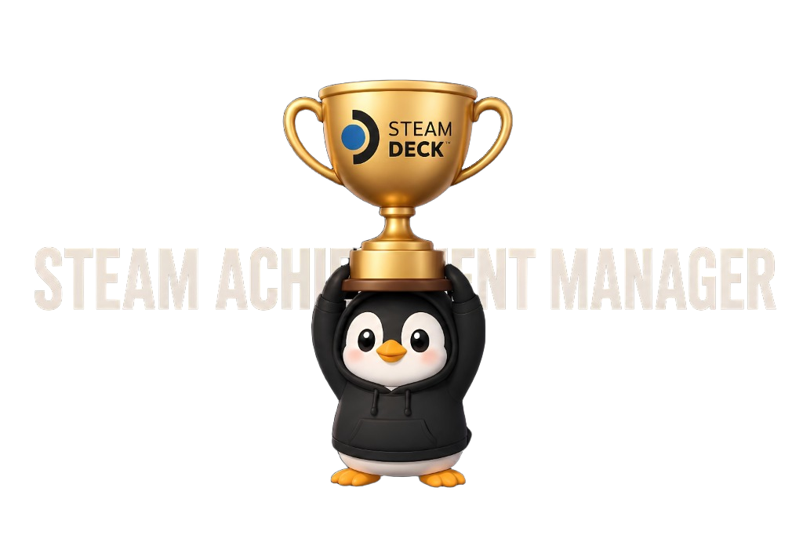

🌐 **Languages:** [Русский](../../README.md) • [English](README_en.md) • [简体中文](README_zh-CN.md) • [繁體中文](README_zh-TW.md) • [日本語](README_ja.md) • [한국어](README_ko.md) • **[Deutsch](README_de.md)** • [Français](README_fr.md) • [Español](README_es.md) • [Español (Latinoamérica)](README_es-419.md) • [Italiano](README_it.md) • [Português (Brasil)](README_pt-BR.md) • [Português (Portugal)](README_pt.md) • [Polski](README_pl.md) • [Українська](README_uk.md) • [Türkçe](README_tr.md) • [Nederlands](README_nl.md) • [Čeština](README_cs.md) • [Magyar](README_hu.md) • [Svenska](README_sv.md) • [Dansk](README_da.md) • [Norsk](README_no.md) • [Suomi](README_fi.md) • [Ελληνικά](README_el.md) • [Български](README_bg.md) • [Română](README_ro.md) • [ไทย](README_th.md) • [Tiếng Việt](README_vi.md) • [Bahasa Indonesia](README_id.md) • [Bahasa Melayu](README_ms.md)

  

<h1 align="center">SAM (Steam Achievement Manager) für Decky Loader</h1>

  <em>Speziell erstellt für [Decky Loader Russia](https://www.deckyloader.ru/)</em>

---

**SAM** is a native plugin for [Decky Loader](https://decky.xyz/) on **Steam Deck** (SteamOS), allowing you to manage Steam achievements directly from Gaming Mode (Quick Access Menu).

### 🎯 Why use this plugin?
- **Replayability:** Lock (reset) already unlocked achievements to experience the satisfaction of unlocking them again during a new playthrough.
- **Fixing bugged achievements:** If a glitch or connectivity issue prevented an achievement from unlocking legitimately, you can unlock it with one tap.
- **Native Steam Deck experience:** No need to switch to Desktop Mode or launch external Windows apps through Proton — fast, responsive, and tailored for gamepad navigation.

## ✨ Features
- 🎮 **Automatic game detection** via Decky Loader API.
- ⚡ **One-click control:** Lock or unlock individual achievements or use bulk actions («Unlock All» / «Lock All»).
- 📜 **Marquee text & responsive UI:** Long achievement titles scroll smoothly; compact square buttons fit QAM perfectly.
- 🔍 **Search & Filters:** Search by name, filter by All / Unlocked / Locked.
- 🌍 **Full 30-language localization:** The entire plugin UI and achievement schema match your Steam language.
- 🛡️ **Built-in Security System:**
  - **VAC Protection:** Valve Anti-Cheat games (CS2, TF2, etc.) are permanently blocked.
  - **Multiplayer Safeguard:** Online games blocked by default; opt-in toggle only accessible when no game is running.
  - **Informative status banners:** Clear notices for Non-Steam shortcuts and games without achievements.

## ⚠️ Safety & Risk Notice
Modifying achievements in multiplayer games may violate terms of service of certain game developers.
- VAC-protected games are **permanently disabled**.
- Multiplayer support is disabled by default and enabled at your own risk.
- It is best used for single-player games.

## 📦 Installation
1. Download `SAM.zip` from [Releases](https://github.com/Kowalski-coder/SAM-for-Decky-Loader/releases) or [deckyloader.ru](https://www.deckyloader.ru/).
2. Open the **Decky Loader** tab in the Quick Access Menu (`...` button).
3. Open Decky Settings (gear icon) -> **Developer** -> **Install plugin from ZIP**.
4. Choose `SAM.zip`.

---

## ☕ Support the Creator
If you enjoy this plugin and want to support ongoing development of plugins and translations:

